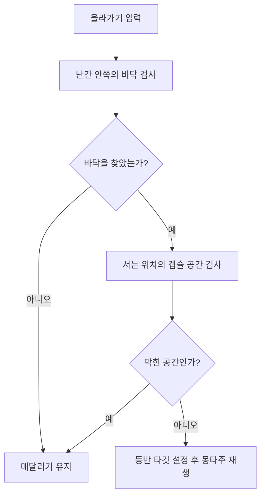

# Concrete Ascent

장애물을 넘고 난간에 매달려 이동하며 위로 올라가는 3인칭 파쿠르 게임입니다. Game Animation Sample Project(GASP)를 참고해 애니메이션과 파쿠르 구조를 구성하고, 매달리기 / 난간 좌우 이동 / 올라가기 / 떨어지기를 직접 추가했습니다.

| 항목 | 내용 |
|---|---|
| 개발 형태 | 개인 프로젝트 |
| 개발 기간 | 작성 예정 |
| 개발 환경 | Unreal Engine / C++ / Blueprint |
| 사용 기술 | Motion Matching / Pose Search / Chooser / Motion Warping / Enhanced Input |
| 주요 구현 | Box 기반 장애물 판정 / 파쿠르 동작과 위치 보정 / 난간 이동과 등반 / 게임 진행과 UI 연결 |

## 플레이 영상

추가 예정

## 개발 목적과 담당 범위

Unreal Engine의 애니메이션 시스템과 C++ 구현을 학습하기 위해 진행한 프로젝트입니다. GASP의 애니메이션과 Motion Matching 구성을 참고하고, 장애물 판정과 파쿠르 실행 흐름을 C++ 중심으로 구성했습니다. 여기에 난간을 잡고 이동한 뒤 올라가거나 떨어지는 동작을 추가해 플레이할 수 있는 행동을 확장했습니다.

ABP와 UI는 그래프에서 결과를 확인하며 수정하는 방식이 효율적이라고 판단해 Blueprint로 작업했습니다. 장애물의 공간 검사, 캐릭터 상태와 이동 제어, 게임 진행은 C++로 구현하고 애니메이션 에셋과 연결했습니다.

| 구분 | 구현 내용 |
|---|---|
| Motion Matching | GASP 기반 이동 애니메이션 구성 / Trajectory와 Pose History 연결 / Pose Search Schema 설정 조정 |
| 장애물 판정 | Box Component 기반 앞뒤 모서리 계산 / 캐릭터 캡슐을 이용한 공간 검사 / Chooser 입력 구성 |
| 파쿠르 실행 | 몽타주 재생 시작점 변경 / 동작별 Warp Target 설정 / 위치와 Notify 구간 조정 |
| 매달려 이동하기 | 공중에서 난간 잡기 / 좌우 이동 / 올라가기 / 떨어지기 |
| 상태 제어 | 일반 이동과 매달리기 입력 분기 / 이동 모드 전환 / 동작 종료 후 충돌과 이동 복구 |
| 게임 진행과 UI | 체크포인트와 리스폰 / 클리어와 실패 처리 / 화면 페이드 / UI와 입력 모드 연결 |

## 핵심 기술

### 1. Motion Matching 구성과 Pose Search Schema 조정

일반 이동 애니메이션은 GASP 구성을 참고해 Motion Matching으로 연결했습니다. `ABP_Player`에서 이동 Trajectory를 생성하고, Pose History를 수집하며 이동 상태에 맞는 애니메이션을 선택하도록 구성했습니다. C++의 [ConcreteAscentAnimInstance.cpp](Source/ConcreteAscent/Private/Player/Animation/ConcreteAscentAnimInstance.cpp)는 캐릭터 참조와 Gait 정보를 제공하고, 애니메이션 갱신과 출력은 ABP에서 처리합니다.

구성 과정에서 가장 어려웠던 부분은 Pose Search Schema의 파라미터 조정이었습니다. Trajectory와 Pose History의 용도는 이해하고 있었지만, 실제 적용에서는 착지 모션의 재생 시점이 의도와 어긋나는 경우가 있었습니다. Schema 설정을 바꾸면서 선택되는 포즈와 착지 전환을 함께 확인하고 조정했습니다.

이 과정에서 애니메이션 데이터를 연결하는 작업과 원하는 시점의 동작이 선택되도록 설정을 맞추는 작업을 함께 다뤘습니다. 일반 이동의 Motion Matching 구성은 유지하면서, 파쿠르 진입은 아래의 몽타주 재생 방식으로 구성했습니다.

**관련 코드 및 에셋**

- 이동 애니메이션과 Trajectory: [Content/Player/Anim/ABP_Player.uasset](Content/Player/Anim/ABP_Player.uasset)
- 캐릭터 정보 전달: [Source/ConcreteAscent/Private/Player/Animation/ConcreteAscentAnimInstance.cpp](Source/ConcreteAscent/Private/Player/Animation/ConcreteAscentAnimInstance.cpp)

---

### 2. Box 기반 파쿠르 판정과 Motion Warping

#### 2-1. 장애물의 기준점을 Box로 계산

참고한 GASP의 장애물은 Spline Component를 사용했지만, 이 프로젝트에서는 Box Component로 앞뒤 모서리와 통과 방향을 계산하는 구성이 더 간단하다고 판단했습니다. [ParkourObstacleBase.cpp](Source/ConcreteAscent/Private/Objects/Obstacle/ParkourObstacleBase.cpp)에서 시각 표현용 메시와 판정용 `TraversalBounds`를 구분하고, Box의 위치와 크기를 파쿠르 판정의 기준으로 사용했습니다.

플레이어 위치를 Box의 로컬 좌표로 변환하고, 각 축의 크기를 반영해 접근한 면을 판단합니다. 플레이어가 접근한 쪽을 앞 모서리로 정하고 반대쪽을 뒤 모서리로 계산하며, 충돌 지점은 모서리 위의 좌우 위치를 정하는 데 사용합니다. 계산한 위치와 방향은 다시 월드 좌표로 변환해 전달합니다.

[ParkourTraversalComponent.cpp](Source/ConcreteAscent/Private/Player/Components/ParkourTraversalComponent.cpp)는 캐릭터의 캡슐 크기를 기준으로 진입 공간과 장애물 위의 통과 공간, 뒤쪽 바닥을 검사합니다. 검사 결과와 캐릭터의 이동 정보를 `FTraversalChooserInputs`로 묶어 Chooser에 전달합니다.

| 입력 정보 | 용도 |
|---|---|
| 앞뒤 모서리와 뒤쪽 바닥의 유무 | 사용할 수 있는 공간 조건 전달 |
| 장애물 높이와 깊이 / 뒤쪽 낙차 | 장애물 형태에 맞는 동작 선택에 사용 |
| 이동 속도 / Gait / MovementMode | 캐릭터의 접근 상태 전달 |

Chooser 평가는 `BP_ParkourTraversalComponent`에서 수행하고, C++에서는 반환된 동작 종류와 몽타주 후보를 받아 실행 정보를 구성합니다.

#### 2-2. 파쿠르 진입 포즈 검색을 몽타주 시작점 처리로 변경

참고한 파쿠르 구성은 캐릭터에 추가된 `attach` 본을 사용해 장애물과의 관계에 맞는 진입 포즈를 검색했습니다. 가상 본으로 대체하는 방법을 시도했지만 원하는 방식으로 해결되지 않았고, 캐릭터 에셋을 바꿀 때마다 본을 추가하는 작업이 반복된다고 판단했습니다.

그래서 파쿠르 진입에서는 포즈 검색 단계를 생략하고, 선택한 몽타주의 `PoseSearchBranchIn` Notify 구간이 끝난 시점부터 동작을 재생하도록 변경했습니다. 이후 장애물에 맞추는 위치와 회전은 Motion Warping으로 보정했습니다.

`StartTraversal()`은 Chooser가 반환한 후보 중 첫 번째 몽타주를 선택합니다. `FindPoseSearchBranchInEndTime()`은 몽타주의 Notify를 확인해 가장 먼저 시작하는 유효한 `PoseSearchBranchIn` 구간의 종료 시간을 찾습니다.

```cpp
UAnimMontage* SelectedMontage = ValidMontages[0];

float StartTime = 0.f;
FindPoseSearchBranchInEndTime(SelectedMontage, StartTime);
```

이 시작 시간을 `PlayTraversalMontage()`에 전달해 파쿠르 동작으로 진입하도록 했습니다.

#### 2-3. 동작 구간에 맞춘 Warp Target과 Notify 조정

파쿠르 중 캐릭터의 위치가 장애물과 어긋나는 문제는 시작 / 중간 / 끝 구간을 나누어 조정했습니다. 장애물에 접근하는 위치, 넘어가는 위치, 착지 위치를 각각 확인하면서 Warp Target과 Motion Warping Notify의 범위를 맞췄습니다.

[ConcreteAscentCharacter.cpp](Source/ConcreteAscent/Private/Player/ConcreteAscentCharacter.cpp)의 `UpdateTraversalWarpTargets()`에서는 앞 모서리 / 뒤 모서리 / 뒤쪽 바닥을 기준으로 목표 위치와 방향을 설정합니다. 동작마다 필요한 타깃을 등록하고, 사용하지 않는 타깃은 제거합니다.

| 동작 | 사용하는 Warp Target |
|---|---|
| Mantle | 앞 모서리 `FrontLedge` |
| Vault | 앞 모서리 `FrontLedge` / 뒤 모서리 `BackLedge` |
| Hurdle | 앞 모서리 `FrontLedge` / 뒤 모서리 `BackLedge` / 착지점 `BackFloor` |

Hurdle의 착지점은 애니메이션에서 얻은 뒤 모서리와 착지 구간의 거리 차를 이용해 수평 위치를 조정하고, 높이는 공간 검사에서 찾은 실제 바닥 위치를 사용합니다. 코드에서 계산한 목표와 몽타주의 Notify 구간을 함께 조정하며 접촉과 착지가 자연스럽게 이어지도록 맞췄습니다.

**관련 코드 및 Blueprint**

- Box 기준 모서리와 방향 계산: [Source/ConcreteAscent/Private/Objects/Obstacle/ParkourObstacleBase.cpp](Source/ConcreteAscent/Private/Objects/Obstacle/ParkourObstacleBase.cpp)
- 공간 검사와 몽타주 선택: [Source/ConcreteAscent/Private/Player/Components/ParkourTraversalComponent.cpp](Source/ConcreteAscent/Private/Player/Components/ParkourTraversalComponent.cpp)
- Warp Target과 몽타주 재생: [Source/ConcreteAscent/Private/Player/ConcreteAscentCharacter.cpp](Source/ConcreteAscent/Private/Player/ConcreteAscentCharacter.cpp)
- Chooser 평가 연결: [Content/Player/BP_ParkourTraversalComponent.uasset](Content/Player/BP_ParkourTraversalComponent.uasset)
- 애니메이션의 구간별 거리 조회: [Content/Player/BP_Player.uasset](Content/Player/BP_Player.uasset)

---

### 3. 매달리기와 난간 이동 확장

샘플에서 제공하는 동작에 더해 난간에 매달린 상태에서 좌우로 이동하고, 위로 올라가거나 손을 놓고 떨어지는 기능을 직접 구현했습니다. 이를 통해 파쿠르 동작 이후에도 플레이어가 다음 이동을 선택할 수 있도록 했습니다.

#### 3-1. 난간 잡기와 좌우 이동

`TryAirLedgeGrab()`은 캐릭터가 공중에 있을 때 매달리기용 장애물을 검사합니다. 난간의 중심과 이동축, 이동 가능한 길이를 구한 뒤 캐릭터의 위치를 난간 축에 투영해 현재 Offset을 계산합니다. 캡슐 반경과 여유 공간을 반영해 난간 끝에서 더 이동하지 않도록 범위를 제한했습니다.

좌우 이동은 난간 위의 Offset을 보간하는 방식으로 처리했습니다. 벽과의 간격과 캐릭터 높이를 반영해 매달릴 위치를 정했습니다.

`MoveAlongLedge()`는 입력 방향에 따라 다음 Offset을 정하고, 좌우 이동 몽타주의 길이를 위치 보간 시간으로 사용합니다. 이동 중에만 컴포넌트 Tick을 활성화하고 도착하면 비활성화합니다. 애니메이션의 재생 시간에 맞춰 난간 위 위치가 이동하도록 연결했습니다.

#### 3-2. 올라갈 공간이 없는 곳에서의 등반 방지

올라가기 기능을 추가했을 때, 난간 위에 장애물이 있어 캐릭터가 설 수 없는 곳에서도 그대로 뚫고 올라가는 문제가 있었습니다. 이를 해결하기 위해 등반을 시작하기 전에 발판과 캐릭터가 들어갈 공간을 확인하도록 수정했습니다.

`CanClimbFromLedge()`는 난간 안쪽에 설 위치를 계산하고 위에서 아래로 Line Trace를 수행해 바닥 높이를 찾습니다. 이후 캐릭터 캡슐의 반높이를 더해 최종 중심 위치를 정하고, 해당 위치에서 `OverlapBlockingTestByChannel()`로 캡슐이 들어갈 공간을 검사합니다. 바닥이 없거나 캡슐이 다른 장애물과 겹치면 등반을 시작하지 않습니다.



검사를 통과하면 `ClimbStand` Warp Target을 등록하고 올라가기 몽타주를 재생합니다. 등반 중에는 Root Motion과 Motion Warping으로 이동하고, 정상 종료 시에는 계산해 둔 서 있는 위치로 최종 보정한 뒤 일반 이동으로 복귀합니다.

#### 3-3. 매달리기 상태와 일반 이동 연결

매달리기 중에는 일반 이동 입력을 난간 이동 / 올라가기 / 떨어지기로 나눠 처리했습니다. 등반 중에는 일반 이동을 제한하고, 몽타주 종료 시 충돌과 이동 상태를 복구하도록 연결했습니다.

손을 놓는 `DropFromLedge()`에서는 남아 있는 난간 몽타주와 타이머를 정리하고 등반용 Warp Target을 제거한 뒤 Falling으로 전환합니다. 일반 파쿠르도 종료 콜백에서 동작 종류에 따라 Walking 또는 Falling으로 복귀하도록 구성했습니다.

**관련 코드**

- 난간의 이동축과 길이: [Source/ConcreteAscent/Private/Objects/Obstacle/LedgeObstacle.cpp](Source/ConcreteAscent/Private/Objects/Obstacle/LedgeObstacle.cpp)
- 매달리기 / 좌우 이동 / 등반 공간 검사: [Source/ConcreteAscent/Private/Player/Components/ParkourTraversalComponent.cpp](Source/ConcreteAscent/Private/Player/Components/ParkourTraversalComponent.cpp)
- 매달릴 위치와 이동 상태 전환: [Source/ConcreteAscent/Private/Player/ConcreteAscentCharacter.cpp](Source/ConcreteAscent/Private/Player/ConcreteAscentCharacter.cpp)

## 추가 구현

### 체크포인트와 리스폰

체크포인트와 낙하 트리거에서 GameMode로 진행 상태를 전달하도록 연결했습니다. 리스폰 시에는 현재 체크포인트 또는 시작 위치를 선택하고, 화면을 어둡게 한 뒤 캐릭터를 이동시킵니다. 페이드가 끝나면 입력을 복구해 다시 플레이할 수 있도록 구성했습니다.

### 게임 모드와 결과 UI

일반 모드에서는 리스폰을 허용하고, 하드 모드에서는 리스폰 요청을 실패 처리로 연결했습니다. 클리어와 실패 화면의 위젯은 Blueprint로 구성하고, C++의 PlayerController에서 화면 전환과 입력 모드를 관리했습니다. 결과 화면을 표시할 때에는 HUD를 정리하고 게임을 일시정지한 뒤 UI 조작으로 전환합니다.

**관련 코드**

- 체크포인트와 리스폰 흐름: [Source/ConcreteAscent/Private/GameMode/ConcreteAscentGameModeBase.cpp](Source/ConcreteAscent/Private/GameMode/ConcreteAscentGameModeBase.cpp)
- 하드 모드의 실패 처리: [Source/ConcreteAscent/Private/GameMode/ConcreteAscentHardGameMode.cpp](Source/ConcreteAscent/Private/GameMode/ConcreteAscentHardGameMode.cpp)
- 화면 전환과 입력 모드: [Source/ConcreteAscent/Private/Player/Controller/ConcreteAscentPlayerController.cpp](Source/ConcreteAscent/Private/Player/Controller/ConcreteAscentPlayerController.cpp)
